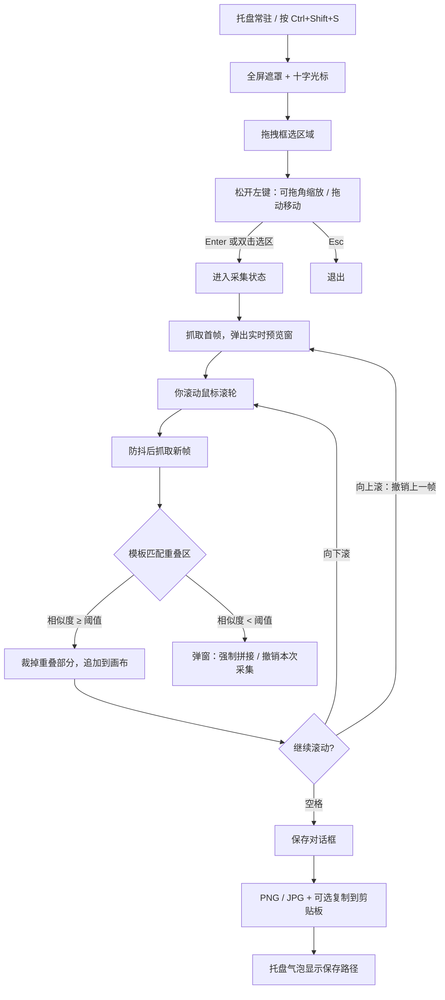

# 长截图 LongShot

> Windows 滚动长截图工具 —— **你自己滚动，程序负责拼接**。

把一屏放不下的网页、文档、代码、聊天记录，滚一滚滚轮就能变成一张完整长图。
程序不控制页面滚动，只监听你的滚轮事件、截取选区、用模板匹配对齐重叠区域，逐帧拼成一张图。工作方式对标 PixPin / FastStone 的「手动滚动长截图」。

Python + PyQt6 实现，支持多显示器与高 DPI 缩放，可打包为单文件 exe 放在托盘常驻。

---

## 目录

- [核心特性](#核心特性)
- [工作流程](#工作流程)
- [快速开始](#快速开始)
- [使用说明](#使用说明)
- [设置项](#设置项)
- [工作原理](#工作原理)
- [项目结构](#项目结构)
- [已知限制](#已知限制)
- [常见问题](#常见问题)
- [开发与贡献](#开发与贡献)
- [许可证](#许可证)

---

## 核心特性

**框选**

- 全局快捷键唤起（默认 `Ctrl+Shift+S`，可在设置中修改，带占用检测）
- 全屏半透明深色遮罩 + 十字光标，拖拽框选；选区内清晰、选区外压暗
- 松开鼠标后进入可调整状态：拖动四角/四边缩放、拖动内部整体移动，实时显示尺寸
- 最小选区 50×50 像素；`Enter` 或双击选区内部开始采集，`Esc` 取消
- 多显示器支持，每块屏幕独立遮罩，副屏坐标正确
- 支持 125% / 150% 等高 DPI 缩放（Per-Monitor V2），坐标全部按物理像素对齐，不会错位

**采集与拼接**

- 向下滚动滚轮采集下一屏，向上滚轮撤销上一帧（可在设置中反转方向）
- 滚轮事件防抖合并，一次连续滚动只抓一帧，避免重复帧与抖动
- OpenCV 灰度模板匹配（`TM_CCOEFF_NORMED`）计算重叠区域，自动裁掉重叠部分
- 自动识别并排除右侧滚动条区域，减少误匹配
- 匹配相似度低于阈值时弹窗提示，可选择「强制拼接」或「撤销本次采集」
- 连续 3 次匹配失败自动暂停，避免拼出一堆错位图
- 黑屏帧识别（锁屏 / UAC / 独占全屏），不会把黑图拼进去
- 高度上限 20000 px 自动停止；内存占用超过 300 MB 暂停并询问
- 整张长图实时显示在悬浮预览窗中，可拖动查看，随时确认拼接结果

**保存**

- `空格` 结束采集，弹出保存对话框：缩略图预览、文件名、目录、格式
- PNG 无损 / JPG（画质 70~100 可调）
- 默认文件名 `longshot_年月日_时分秒`，可勾选保存后复制到剪贴板
- 保存成功托盘气泡提示完整路径，并提供「打开截图保存目录」

**其他**

- 深色 UI，设置入口收敛为遮罩右上角的齿轮图标，界面尽量简洁
- 托盘常驻、不占任务栏，单实例运行（重复启动不会开两份）
- 可设置开机自启（写入 `HKCU\Software\Microsoft\Windows\CurrentVersion\Run`）
- 全局异常钩子，崩溃信息写入 `%APPDATA%\LongShot\logs\error.log`，不会静默闪退

---

## 工作流程



---

## 快速开始

### 环境要求

- Windows 10 / 11（x64）
- Python 3.10+（开发环境为 3.14）

### 运行源码

```bash
pip install -r requirements.txt
python main.py
```

启动后没有主窗口，只在系统托盘出现图标。

### 打包为 exe

仓库不提交二进制图标，打包前先生成：

```bash
python tools/make_icons.py
```

然后使用附带的 spec（产物在 `dist\长截图.exe`，单文件、无控制台）：

```bash
python -m PyInstaller --noconfirm 长截图.spec
```

或者直接命令行打包：

```bash
python -m PyInstaller --noconfirm --onefile --windowed --name "长截图" ^
    --icon "resources\icon.ico" --add-data "resources;resources" main.py
```

---

## 使用说明

### 完整流程

1. 双击运行 → 托盘出现图标（任务栏不占位）
2. 按 `Ctrl+Shift+S` → 屏幕变暗，进入框选状态
3. 拖拽画出要截的区域 → 松开后可拖角/边微调、拖内部移动
4. 按 `Enter` 或双击选区内部 → 进入采集状态，选区外侧出现白色角标，右侧（放不下时左侧）出现实时预览窗
5. 用鼠标滚轮滚动页面 → 每滚一屏自动拼接一次，预览窗实时更新
6. 滚多了就向上滚一帧撤销；拼接完成按 `空格` → 保存对话框
7. 选择格式与画质，保存；托盘气泡显示保存路径

### 操作对照表

| 操作 | 作用 |
| --- | --- |
| `Ctrl+Shift+S`（可改） | 唤起截图（全局生效，任何前台程序下都可用） |
| 按住左键拖拽 | 绘制选区 |
| 拖动选区内部 | 整体移动选区 |
| 拖动四角 / 四边 | 缩放选区 |
| `Enter` / 双击选区内部 | 开始采集 |
| `Esc` | 取消采集或退出截图 |
| 滚轮向下 | 采集下一屏 |
| 滚轮向上 | 撤销上一帧 |
| `空格` | 结束采集并保存 |
| 遮罩右上角齿轮 | 打开设置 |

> 采集时鼠标请停留在选区内部滚动，部分程序只把滚轮发给鼠标下的窗口。

---

## 设置项

设置面板分四个页签，配置保存在 `%APPDATA%\LongShot\config.json`。

| 页签 | 选项 | 默认值 | 说明 |
| --- | --- | --- | --- |
| 快捷键 | 唤起快捷键 | `Ctrl+Shift+S` | 录制式输入；被其他程序占用时提示更换，且切换失败不会丢失原快捷键 |
| 采集 | 重叠匹配搜索高度 | 200 px | 在上一帧底部多少像素内寻找重叠；页面越长可适当调大 |
| 采集 | 匹配相似度阈值 | 0.80 | 低于该值判定为匹配失败并弹窗；画面变化剧烈时可调低 |
| 采集 | 滚轮防抖间隔 | 120 ms | 连续滚动的合并间隔 |
| 采集 | 滚动方向反转 | 关 | 开启后向上滚采集、向下滚撤销 |
| 采集 | 长图高度上限 | 20000 px | 到达上限自动停止并保存 |
| 保存 | JPG 默认画质 | 90 | 范围 70~100，仅 JPG 生效 |
| 保存 | 默认保存目录 | `图片\LongShot` | 可在对话框中临时更换 |
| 保存 | 保存后复制到剪贴板 | 开 | 保存成功即写入剪贴板 |
| 其他 | 开机自启 | 关 | 写入当前用户的启动项 |

---

## 工作原理

### 1. 坐标体系：全程使用物理像素

高 DPI 下 Qt 的逻辑坐标与截屏的物理像素不是一回事。本项目的约定是：

- 选区、鼠标位置、`mss` 抓屏区域统一使用**物理像素**
- 每块屏幕通过 `GetWindowRect(hwnd)` 拿到物理矩形与缩放比（DPI 125% / 150%）
- 只在摆放遮罩、提示条、预览窗时把物理坐标换算成 Qt 逻辑坐标

因此 150% 缩放下框选 600 像素宽，截出来的图就是 600 像素宽，不会缩水一半。

### 2. 遮罩不出现在截图里

遮罩、提示条、预览窗都调用了：

```python
SetWindowDisplayAffinity(hwnd, WDA_EXCLUDEFROMCAPTURE)  # 0x11
```

Windows 10 2004+ 下，这些窗口会被截屏 API 直接排除，因此采集时不会把半透明遮罩、边框、预览窗拍进长图。实测截取画面亮度与真实画面平均差 0.1，无可见影响。

### 3. 全局快捷键

Win32 `RegisterHotKey` 必须在**注册它的那个线程**的消息循环里接收 `WM_HOTKEY`，所以热键管理器跑在独立的线程中，主线程通过 `PostThreadMessage` 把注册任务丢过去。

冲突检测使用返回码 `ERROR_HOTKEY_ALREADY_REGISTERED (1409)`。
切换快捷键时采用**双 ID 交替**：先往备用 ID 注册新组合，注册成功才释放旧 ID —— 这样新快捷键被占用时，旧快捷键依然可用，不会出现「改键失败后没有任何快捷键」的情况。

### 4. 滚轮监听与防抖

`pynput` 监听全局滚轮事件（遮罩是工具窗口，不一定能拿到焦点，因此不依赖窗口事件）。
一次物理滚轮滚动会连发多个事件，防抖策略：

- 每个事件重置 120 ms 定时器
- 连续滚动超过 350 ms 时提前合并触发
- 抓帧期间（`busy`）不重复提交任务，避免帧序错乱

### 5. 重叠区域匹配

```text
上一帧 prev          当前帧 cur
┌──────────────┐
│              │
│              │
│  底部 S 行    │ ──► 作为模板 template
└──────────────┘
                 ┌──────────────┐
                 │              │
                 │  ┌────────┐  │
                 │  │template│  │  ◄── 在当前帧上滑动匹配
                 │  └────────┘  │
                 └──────────────┘
```

具体做法：

1. 双帧转灰度，裁掉右侧 16×scale 像素（排除滚动条）
2. 取上一帧**底部 S 行**（`match_search_height`）作为模板
3. 用 `cv2.matchTemplate(..., TM_CCOEFF_NORMED)` 在当前帧上滑动，得分最高的位置即重叠起点
4. 模板纹理过少（`std < 2`，纯色区域）时跳过匹配，判为「画面无变化」
5. 为避免模板过窄导致误配，依次用 1/2/3 倍高度加宽模板重试
6. 新内容高度 = 模板底部位置 + 模板高度，只把这段新增像素追加到画布

匹配失败（得分低于阈值、或当前帧全黑）会弹窗，交给你决定「强制拼接」还是「撤销本次采集」。

### 6. 内存策略

- 画布用 numpy **预分配 + 容量倍增**，只在末尾追加新行，不反复拷贝整张图
- 每个片段只保留在内存中，不落盘
- 占用超过 300 MB 时暂停并询问；选择继续则临时把上限提高 1.5 倍，避免反复弹窗

### 7. 异常兜底

- 遮罩是 `Tool` 窗口，可能拿不到键盘焦点，因此**同时**注册了全局 `Enter` / `Esc` 监听与窗口按键事件
- 锁屏 / UAC / 独占全屏下抓到的帧全黑，`frame.max() <= 8` 判为无效帧，暂停而不是拼进去
- 全局 `sys.excepthook` 把堆栈写进日志并在托盘提示，不静默退出

---

## 项目结构

```text
长截图/
├── main.py            # 入口：单实例、托盘、菜单、异常钩子
├── config.py          # 配置读写（%APPDATA%\LongShot\config.json）
├── native.py          # Win32 封装：屏幕物理矩形、DPI、窗口排除截屏、开机自启
├── theme.py           # 深色主题（QPalette + QSS）
├── hotkey.py          # 全局热键：解析、注册线程、冲突检测、安全切换
├── overlay.py         # 框选遮罩：多屏遮罩、选区绘制/移动/八向缩放、提示条、采集外框
├── collector.py       # 采集调度：滚轮监听、防抖、抓帧、拼接、暂停与上限保护
├── stitcher.py        # 拼接算法：灰度模板匹配、偏移计算、黑帧判定
├── preview.py         # 实时预览悬浮窗
├── dialogs.py         # 保存对话框、设置面板、快捷键录制控件
├── session.py         # 一次完整截图会话的状态编排
├── tools/
│   └── make_icons.py  # 生成 icon.png / icon.ico
├── resources/         # 图标（由脚本生成，不入库）
├── requirements.txt
└── 长截图.spec        # PyInstaller 打包配置
```

模块之间只通过 Qt 信号与简单数据对象通信，没有全局状态耦合：

```text
LongShotApp(托盘/热键) ──► CaptureSession ──► SelectionController(框选)
                                   │                │
                                   │                ▼
                                   │           MaskOverlay × N 屏
                                   ▼
                            FrameCollector ──► CaptureWorker(线程内 mss)
                                   │                │
                                   ▼                ▼
                             PreviewWindow      stitcher.match_offset
                                   │
                                   ▼
                              SaveDialog ──► PNG / JPG
```

---

## 已知限制

- **仅支持 Windows**（依赖 `RegisterHotKey`、`SetWindowDisplayAffinity`、`mss` 的 Win32 后端）
- **独占全屏游戏、锁屏界面、UAC 安全桌面**抓不到画面，程序会识别黑帧并暂停，不会崩溃
- 页面存在**固定悬浮栏、播放中的视频、滚动动画、瀑布流懒加载**时，重叠区域不可靠，会触发匹配失败；此时可放慢滚动，或用「强制拼接」接受一条接缝
- 采集时**不会自动滚动页面**（这是设计选择：由你控制节奏，程序只负责对齐拼接）
- 只支持竖直方向长截图，暂不支持横向
- JPG 会二次有损压缩，追求画质请选 PNG
- `mss` 抓屏在极少数带保护的内容（DRM 视频）上会得到黑帧

---

## 常见问题

**Q：按快捷键没反应？**
A：默认 `Ctrl+Shift+S` 常被输入法、浏览器扩展或截图软件占用。首次启动若检测到冲突会自动弹出设置面板，请换一个组合键（例如 `Ctrl+Alt+J`）。

**Q：滚轮滚了但没拼上去？**
A：确认鼠标停在**选区内部**再滚动；若某次匹配失败会弹窗询问，选择「强制拼接」或「撤销」。连续失败 3 次会自动暂停。

**Q：拼出来的图有错位 / 重复？**
A：先把滚动放慢，让每帧之间留出稳定的重叠区；再考虑把「重叠匹配搜索高度」调大（如 300）或把阈值调低（如 0.7）。

**Q：为什么截图里看不到遮罩和预览窗？**
A：这是刻意的 —— 相关窗口都设置了 `WDA_EXCLUDEFROMCAPTURE`，不会污染截图。

**Q：exe 运行时被 SmartScreen 或杀软拦截？**
A：exe 未做代码签名，PyInstaller 打包的程序常被误报。可选择「更多信息 → 仍要运行」，或直接从源码运行。

---

## 开发与贡献

```bash
git clone https://github.com/thinkerzero2005/LongShot.git
cd LongShot
pip install -r requirements.txt
python tools/make_icons.py
python main.py
```

欢迎提 Issue / PR。改动拼接算法时建议先用合成图自测：把一张长图切成带重叠的若干片，按顺序喂给 `stitcher.match_offset`，验证偏移量与行号连续性，再上真实页面验证。

---

## 许可证

[MIT](LICENSE) © 2026 ThinkerZero
